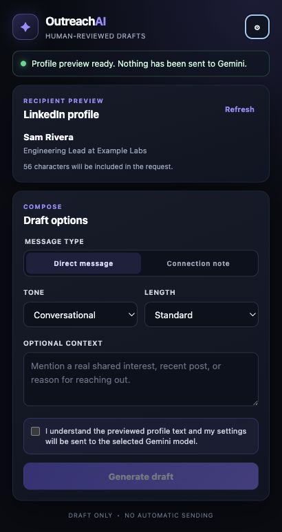
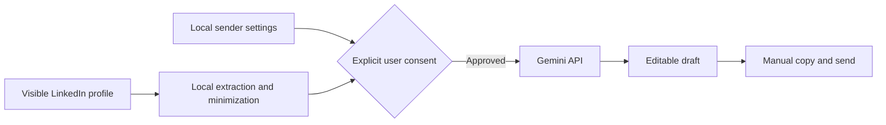

# AI Outreach Assistant

[](https://github.com/Gauravraj004/AI-outreach-assistant/actions/workflows/ci.yml)
[](LICENSE)
[](public/manifest.json)

A privacy-conscious, human-in-the-loop Chrome extension that creates grounded LinkedIn outreach drafts from visible profile context using a user-provided Gemini API key.

The extension never sends a message, clicks LinkedIn action buttons, or runs bulk outreach. The user previews the recipient data, explicitly approves each AI request, reviews the draft, and copies it manually.



## Why this project exists

Writing relevant outreach takes research and care. This project reduces blank-page work without removing human judgment. It demonstrates browser-extension architecture, prompt grounding, privacy-aware product design, structured model output, automated testing, and release engineering.

## Features

- Direct-message and connection-note workflows
- First-run setup checklist and reusable networking, recruiting, collaboration, and founder-conversation goals
- Explicit preview and consent before profile data leaves the browser
- Configurable tone, length, sender profile, and Gemini model
- Guided in-extension sender-profile setup, with local resume import and review
- Bring-your-own-key setup stored in Chrome local extension storage
- API key sent through the `x-goog-api-key` header instead of the URL
- Robust profile extraction with noise removal, deduplication, and a 12,000-character cap
- Structured JSON parsing and human-readable API errors
- Editable draft, live character limit, regenerate, and copy controls
- Optional local storage for only the five most recent drafts, with restore and clear controls
- Local data export (excluding API keys) and one-click deletion of all locally stored extension data
- Non-blocking review warnings for placeholders, recipient mismatch, and overly strong claims
- No backend, analytics, automated sending, or bulk scraping

## Install from source

Requirements: Node.js 22 or newer and Chrome.

```bash
git clone https://github.com/Gauravraj004/AI-outreach-assistant.git
cd AI-outreach-assistant
npm ci
npm run build
```

Then:

1. Open `chrome://extensions`.
2. Enable **Developer mode**.
3. Select **Load unpacked**.
4. Choose the generated `dist/` folder.
5. Open the extension settings and add a dedicated [Gemini API key](https://aistudio.google.com/apikey). Upload a PDF, `.txt`, or `.md` resume once; the extension reads it locally. If you opt in, **Create profile** uses one Gemini request to create an editable sender profile and prefill your name when clear. Review and save it before generating outreach.
6. Visit a LinkedIn member profile, preview the extracted information, approve the request, and generate a draft.

## Data flow



The API key, sender profile, preferences, and optional recent drafts are stored in `chrome.storage.local`. When the user clicks **Generate**, up to 12,000 characters of visible profile text plus the sender context and instructions are sent directly to Google's Gemini API. See [PRIVACY.md](PRIVACY.md) and the [threat model](docs/THREAT_MODEL.md).

## Architecture

```text
src/
├── content/      Profile extraction and content-script entry point
├── popup/        Popup UI and interaction controller
├── prompts/      Pure prompt construction
├── services/     Gemini and local-storage adapters
└── shared/       Limits, validation, and response parsing
```

Vite produces a module-based popup bundle and a separate IIFE content script compatible with Chrome Manifest V3. See [docs/ARCHITECTURE.md](docs/ARCHITECTURE.md) for design decisions.

## Quality checks

```bash
npm run check       # formatting, lint, unit tests, build, evaluation
npm run test:e2e    # browser-level popup tests
npm run package     # production ZIP
```

Unit tests cover prompt construction, response parsing, storage behavior, API failure classification, validation, limits, and DOM-based profile extraction. GitHub Actions runs these checks, browser tests, and secret scanning on every pull request.

## Evaluation

`npm run evaluate` executes deterministic checks against anonymized fixtures for connection-note length, recipient-name inclusion, required grounding phrases, and placeholder leakage. This is an engineering regression suite, not a scientific model-quality benchmark. See [docs/EVALUATION.md](docs/EVALUATION.md).

## Demo

The popup preview above shows the review-first workflow: setup a local sender profile, preview visible recipient data, choose an outreach goal, generate, then edit and copy manually. No action is sent automatically.

## Responsible use

Use the extension for relevant, truthful, low-volume communication. Follow LinkedIn's terms, applicable privacy and anti-spam laws, and recipient preferences. Do not use it for deceptive claims, automated sending, bulk scraping, or harassment. Generated text can be wrong and must be reviewed.

## Contributing and security

- Read [CONTRIBUTING.md](CONTRIBUTING.md) before opening a pull request.
- Report vulnerabilities using the instructions in [SECURITY.md](SECURITY.md).
- Review planned changes in [CHANGELOG.md](CHANGELOG.md).

## Author

Created and maintained by [Gaurav Raj](https://github.com/Gauravraj004).

## License

[MIT](LICENSE)
