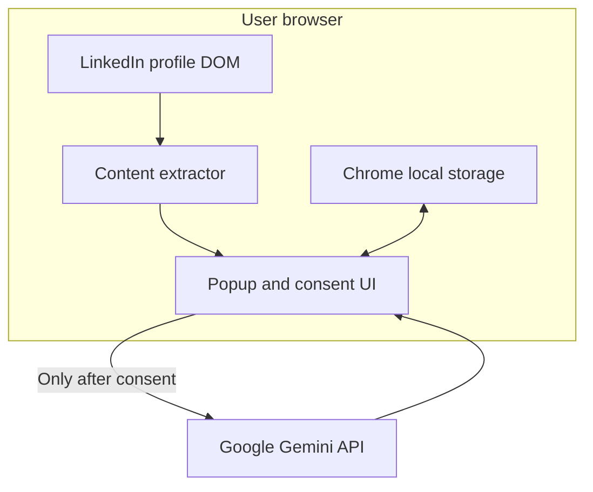

# Architecture

## Design goals

The extension prioritizes explicit consent, factual grounding, maintainability, minimal permissions, and user-controlled sending.

## Components

- `src/content/profile-extractor.js` reads the current profile DOM, removes interface noise and duplicate lines, and caps output.
- `src/content/content.js` exposes extraction through a narrow Chrome message action.
- `src/popup/main.js` coordinates settings, consent, generation, errors, and draft review.
- `src/prompts/build-prompt.js` is a pure function that builds grounded instructions.
- `src/services/gemini-client.js` owns the only external network request.
- `src/services/storage.js` owns local persistence and retention limits.
- `src/shared/` contains validation, response parsing, configuration, and limits.

## Build strategy

The popup is bundled as an ES module through Vite. Chrome content scripts cannot be declared as ES modules, so a second Vite build emits the content entry point as one IIFE bundle. Static manifest and icon files are copied from `public/`.

## Trust boundaries

LinkedIn DOM and Gemini output are untrusted inputs. They are treated as text, never inserted as HTML, and model output is parsed against a narrow application shape.
